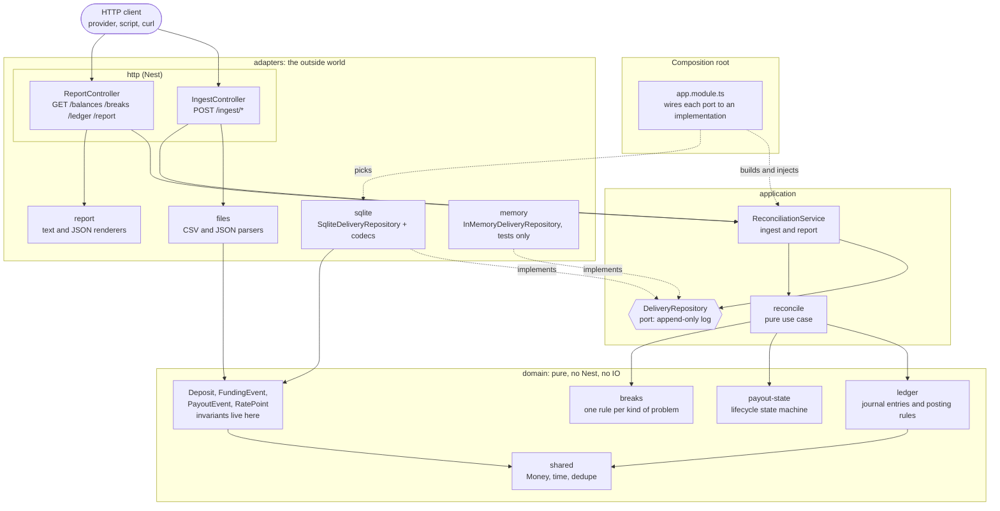

# Architecture

Pragmatic hexagonal architecture. Complements `PLAN.md` (what to build) and `BRIEF.md` (the assignment). Update this file in the same commit that changes a decision.

## Overview



Arrows point in the direction of dependency, so everything points inward: `adapters` depend on `application`, and `application` on `domain`, never the other way. A dotted arrow means "implements" or "wires". Nest lives only in `adapters/http` and the composition root.

**An ingest request** goes `IngestController` → parser (`files`) → domain entity (the factory validates it) → `ReconciliationService.ingest` → `DeliveryRepository.append`. Nothing is stored if any record is invalid.

**A report request** goes `ReportController` → `ReconciliationService.report` → reads the whole delivery log → `reconcile` (dedupe, replay payouts, post the ledger, run the break rules) → renderer → response. The ledger and the breaks are never stored: they are rebuilt from the log every time.

```
src/
  domain/          pure: no Nest, no IO, no file formats
    shared/        money, decimal, time
    rates/         rate table
    ledger/        journal entries, posting rules
    deposits/      deposit entity + invariants
    funding/       funding event entity (provider converts USDT → Bs)
    payouts/       payout event entity + lifecycle state machine
    breaks/        break model + rules (what does not reconcile)
  application/     use cases (reconcile), the ingestion/report service and its ports
  adapters/http/   Nest controllers: the only door in (ingest + reports)
  adapters/files/  CSV/JSON parsers + file → use case facade
  adapters/memory/ in-memory delivery repository (unit tests)
  adapters/sqlite/ SQLite delivery repository (the one the server uses)
  adapters/report/ text and JSON renderers (pure functions of the result)
  config/, app.module.ts, main.ts   composition root (wires ports to implementations)
scripts/run-output.ts   client of the API: sends the provided files and saves the report to out/
test/{domain,application,adapters,http,scripts}/, test/architecture.spec.ts
```

## Decisions

- **Dependency rule:** `adapters → application → domain`, never the reverse. Enforced by `test/architecture.spec.ts` (domain and application must not import adapters or `@nestjs`).
- **Nest is the delivery mechanism, nothing more.** It is confined to `adapters/http`, `app.module.ts` and `main.ts` (enforced by test). Controllers parse the request, call `ReconciliationService` and shape the response; the service and everything below it are plain classes. Adding the API changed nothing in `domain/` or `application/`.
- **A request is all or nothing.** If any record of an ingest request is invalid the answer is 422 with the offending lines and nothing is stored; a corrected file can be sent again because ingestion is idempotent.
- **Ports only when a second implementation exists.** The only one is `DeliveryRepository` (in-memory for unit tests, SQLite for real). Both pass the same contract test (`test/support/delivery-repository-contract.ts`).
- **State is an append-only delivery log.** The service stores what arrived, in order and tagged by batch; nothing is rewritten. Reports are always rebuilt from the log with the pure `reconcile`, so they are reproducible.
- **Ingestion is idempotent by rule:** a delivery identical to one from an earlier batch is dropped, so re-sending files changes nothing; repeats inside one batch and deliveries with different content are kept so they show up as DUPLICATE_DELIVERY / EVENT_CONFLICT. Appends are atomic (one transaction) and the service handles one ingestion at a time, so concurrent identical requests are stored once.
- **Records are stored as plain values and rebuilt through the domain factories** (`adapters/sqlite/codecs.ts`), so whatever comes out of the database is validated and compares equal to what went in.
- **Business rules in the domain, formats in adapters.** Invariants live in domain constructors (e.g. `createDeposit`); adapters only map source fields to domain input.
- **Use cases are pure.** `reconcile(domain objects, config)` has no IO and no clock; the cutoff is injected. Adapters (`reconcileFiles`) parse, call the use case and surface bad rows instead of dropping them.
- **The ledger is derived, not stored.** It is rebuilt from the delivery log on every report, with deterministic entry ids.
- **Domain dependencies:** decimal.js and luxon only (pure, no IO).
- **Adding a source:** a domain entity with a `createX` factory (invariants + fingerprint), a posting rule if it moves money, an adapter function `record → domain input` (`parseTable` / `parseJsonRecords`), and wiring in `reconcile`.
- **Idempotency is a domain rule:** every source is deduplicated by its id (`dedupeById`): first delivery wins, identical repeats are ignored, differing repeats are reported as conflicts.
- **Payout lifecycle is a state machine** (`payout-state`): events are replayed in a total order (instant, lifecycle step, id), so delivery order never matters. Only accepted events reach the ledger; illegal ones are rejected, and money-moving events that skip a step are applied and flagged as irregular.
- **Breaks are pure rules over a context.** Each rule is a function `context → Break[]` in a list (`funding-rules`, `payout-rules`, `balance-rules`, `ingestion-rules`); `findBreaks` runs them and orders the report (severity, instant, id) with deterministic ids. A new check = one function in the list. Severity comes from one table.
- **Reports are pure functions of the result.** No clock, no randomness: two runs over the same files produce identical bytes (`out/run-output.txt` / `.json`, produced through the API), so a rerun can be diffed. Instants are stored in UTC and only converted to the configured zone when rendering.
- **Ledger order:** entries are sorted by instant only; ties keep source order (deposits, fundings, payouts) via a stable sort.
